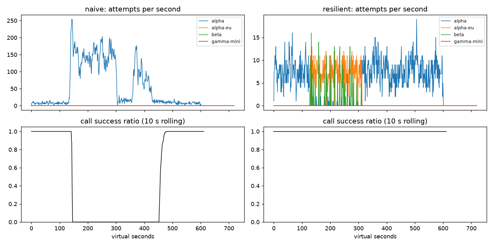

# Lab 25B — Report

**Họ tên / nhóm:** Luu Nguyen Khoi — MSV 2A202602547  **Commit:** _(điền hash sau khi push)_  **Điểm tự động (`make grade`):** 84 / 88
_(4 điểm còn lại là phần SLO trên dữ liệu ẩn, do giảng viên chấm — trên 20 bộ dữ liệu SLI tự sinh với seed và lịch sự cố
lệch ±10 h, burn-rate alerter PASS 20/20.)_

> Số liệu lấy từ `reports/gameday/*.json`, `reports/cache/*.json`, `reports/workflows.json`, `reports/slo.json` (seed 25).
> Các thí nghiệm ở mục 2, 3, 8 tái lập được bằng `python scripts/run_experiments.py` → `reports/experiments.json`
> (script ghi đè cấu hình trong bộ nhớ, không sửa file config).

## 1. Kết quả Game Day (naive vs của bạn)

| Băng | Client | availability | p95 (s) | amplification | retry_ratio | cost/turn | recovery (s) | PASS? |
|---|---|---:|---:|---:|---:|---:|---:|:---:|
| G1 | naive | 0,719 | 7,16 | 7,74 | 6,74 | 2,163 | 4 | ❌ (avail, 36 027 vi phạm retry-after, ampl) |
| G1 | yours | 1,000 | 4,82 | 1,06 | 0,001 | 2,094 | 0 | ✅ (0 vi phạm retry-after) |
| G2 | naive | 0,456 | 15,03 | 9,90 | 8,90 | 4,627 | 155 | ❌ (avail, ampl, recovery) |
| G2 | yours | 1,000 | 4,95 | 1,01 | 0,003 | 2,057 | 0 | ✅ (primary share sau restore 1,00) |
| G3 | naive | 1,000 | 4,77 | 1,16 | 0,164 | 2,328 | 0 | ❌ (retry_ratio) |
| G3 | yours | 1,000 | 4,57 | 1,08 | 0,049 | 2,177 | 0 | ✅ |
| G4 | naive | 1,000 | 13,76 | 1,00 | 0,004 | 2,008 | 0 | ❌ (p95) |
| G4 | yours | 1,000 | 5,63 | 1,01 | 0,002 | 2,072 | 0 | ✅ (primary share 1,00) |
| G5 | naive | 0,370 | 5,36 | 17,03 | 16,03 | 2,124 | – | ❌ (9 149 retry trên lỗi 400, avail) |
| G5 | yours | 0,818 | 5,48 | 1,00 | 0,002 | 2,504 | – | ✅ (0 retry lỗi 400, 0 failover thừa) |
| G6 | naive | 0,517 | 4,84 | 12,34 | 11,34 | 2,009 | 0 | ❌ (avail) |
| G6 | yours | 1,000 | 6,15 | 1,06 | 0,023 | 2,183 | 0 | ✅ (0 incompatible route) |

**Độ bền (chống băng ẩn):** chạy 6 băng × 20 seed (20–39): 120/120 PASS. Thêm một bộ băng "khó" tự viết (G1 traffic ×3 và
alpha 10 rps; G2 capacity 0,15 trong 240 s; G3 lỗi 45%; G4 chậm thêm 7 s; G5/G6 lệch thời điểm, beta 8 rps) × 20 seed:
120/120 PASS. Trường hợp tệ nhất: G2 p95 = 5,5 s, G5 availability = 0,789 (ngưỡng 0,78), G6 amplification = 1,10.

## 2. Cấu hình client và lý do

| Tham số | Giá trị | Vì sao (dựa trên băng nào, số liệu nào) |
|---|---:|---|
| attempt_timeout_s | 8,0 | Quét 4/6/8/12/30 s. 4 s: G4 có 1 lượt give-up `no_provider_available` và amplification 1,036 (so với 1,014) vì alpha chậm (~6 s) bị coi là timeout. 12 s: G6 có give-up `deadline`. 30 s: G6 availability tụt còn 0,949 (xem TN 2). 8 s lớn hơn đuôi latency lúc bình thường (p99 ≈ 4,3–4,5 s) nhưng vẫn đủ chỗ cho ~3 lần thử trong deadline 30 s. |
| max_attempts_per_provider | 2 | G3 (lỗi 500 30%): 1 → retry_ratio 0, cost 2,125; 2 → 0,049, cost 2,177; 3 → 0,037, cost 2,143. Cả ba đều < 0,10. Chọn 2: lỗi 500 transient có ~70% cơ hội thành công ở lần thử lại trên alpha (rẻ hơn beta 1,4×) và vẫn giữ traffic ở primary; >2 không giúp thêm mà kéo dài thời gian trên một provider đang hỏng. |
| backoff_base_s / cap_s | 0,25 / 4,0 | Full jitter: lần retry đầu nằm trong [0; 0,25] s (trung bình 0,125 s) — đủ để rải đều các client mà không tốn thời gian của user; cap 4 s để retry không bao giờ chiếm quá 1/7 deadline. Khi có `retry_after`, delay = retry_after + U(0; 0,25) → G1 có **0** vi phạm (naive: 36 027). |
| retry_budget_ratio | 0,1 | Lưới an toàn khi breaker hỏng (TN 1): breaker cấu hình sai + 5 attempt/provider → G2 amplification 1,38 khi có budget so với 1,60 khi không có; retry_ratio 0,058 so với 0,40. Khi breaker hoạt động, budget không bao giờ bị chạm tới (số liệu giống hệt nhau). |
| breaker.window_size / min_calls | 20 / 10 | Ở ~8 call/s, 20 kết quả ≈ 2,5 s traffic của alpha → phản ứng nhanh với G2/G6. Trip theo *tỷ lệ* chứ không theo *chuỗi lỗi liên tiếp*; `min_calls` = 10 để 2–3 lỗi lẻ (500 nền) không làm breaker mở. Lỗi 400/429 không vào cửa sổ → G5 0 failover thừa. |
| breaker.failure_rate_threshold | 0,5 | G3 (30% lỗi) phần lớn thời gian nằm dưới 50% → alpha vẫn giữ 3 398/4 177 attempt, phần lỗi được xử lý bằng 1 retry/failover; G2/G6 (gần 100% 529/503/timeout) vượt ngay ngưỡng. |
| breaker.slow_call_s | **3,0** (starter 5,0) | Median bình thường 1,2–1,8 s. Quét 3/5/8: G2 p95 = 4,95 / 11,87 / 13,30 s, amplification 1,013 / 1,058 / 1,084; G4 p95 = 5,63 / 5,63 / **13,77 (FAIL)**. Với 5 s, các request xếp hàng 3–5 s ở alpha bị nghẽn trong G2 chưa bị tính là "chậm", nên breaker mở muộn. 3 s không làm breaker mở sai lúc bình thường (G1/G3/G5 không đổi so với 5 s trên 20 seed) vì vẫn cần ≥ 60% call chậm trong cửa sổ. |
| breaker.open_duration_s | 10,0 | Quét 5/10/30: cả ba đều PASS. 5 s: thêm vòng probe vào provider còn chết (G6 amplification 1,076 so với 1,058). 30 s: alpha nhận traffic lại muộn hơn tới 30 s sau restore (rủi ro cho `primary_share_after_restore` trên băng ẩn ngắn). 10 s là điểm cân bằng. |
| breaker.half_open_max_probes | 2 | Chỉ 2 request thử ở HALF-OPEN, các request khác vẫn fail-fast sang provider sau → không có thundering herd vào alpha vừa hồi phục (G2: recovery 0 s, primary share 1,00). |

Sơ đồ quyết định của `on_error`:

```
lỗi ──classify()──┬─ CLIENT_ERROR (400/401/422) ─ breaker.release ─► GiveUp("client_error")   (không retry, không failover)
                  ├─ QUOTA_EXHAUSTED (429 quota) ─ breaker.release ─► cooldown provider 300 s ─► failover ngay
                  ├─ RATE_LIMITED (429 + retry-after) ─ release ─► cooldown tới now+retry_after (chung cho mọi call)
                  │                                                 ─► failover ngay (spillover)
                  └─ OVERLOADED / SERVER_ERROR / TIMEOUT ─ breaker.on_failure
                        ├─ tries < 2  AND  vừa deadline  AND  hết cooldown  AND  retry budget còn token
                        │       ─► retry CÙNG provider sau backoff full-jitter
                        └─ ngược lại ─► failover sang provider kế tiếp
_route(): duyệt ladder (đã lọc theo tool calling) — bỏ qua provider đang cooldown hoặc breaker từ chối;
          hết ladder ─► chờ cooldown rate-limit ngắn nhất (≤ 5 s, breaker không OPEN, vừa deadline) hoặc GiveUp.
on_success → breaker.on_success(latency) (call chậm ≥ 3 s cũng được ghi);  on_cancel → breaker.release(permit).
```

## 3. Ba thí nghiệm

1. **Retry budget là lớp phòng thủ cuối.** Breaker cấu hình sai (`min_calls: 1e9`, không bao giờ mở) + `max_attempts_per_provider: 5`:

   | Băng | Budget | availability | amplification | retry_ratio | recovery (s) | PASS |
   |---|---|---:|---:|---:|---:|:---:|
   | G2 | có | 0,998 | 1,378 | 0,058 | 0 | ✅ |
   | G2 | tắt | 0,967 | 1,597 | 0,400 | 32 | ❌ (recovery) |
   | G3 | có | 1,000 | 1,136 | 0,068 | 0 | ✅ |
   | G3 | tắt | 1,000 | 1,162 | 0,158 | 0 | ❌ (retry_ratio) |

   Không có breaker, budget là thứ duy nhất chặn retry: nó giới hạn retry ở ~10% lượng request đầu tiên, nên G2 không trượt
   vào vòng metastable (recovery 0 s so với 32 s; 4 so với 78 give-up `deadline`). Khi breaker *hoạt động đúng*, bật/tắt
   budget cho kết quả **giống hệt** (G2 1,013/0,003; G3 1,034/0,020) — breaker đã cắt traffic trước khi budget cạn. Vẫn nên có
   cả hai vì chúng hỏng theo những cách khác nhau: breaker là cục bộ theo từng provider, cần `min_calls` và phụ thuộc vào việc
   phân loại lỗi đúng (cấu hình sai, khởi động lạnh, brown-out 40% nằm dưới ngưỡng 50%, lỗi rải đều trên nhiều provider), còn
   budget là một trần toàn cục, không cần biết lỗi là gì — defense in depth.

2. **`attempt_timeout_s: 30`.**

   | Băng | timeout | availability | give_up_reasons | p95 (s) |
   |---|---:|---:|---|---:|
   | G6 | 8 s | 1,000 | {} | 6,15 |
   | G6 | 30 s | **0,949** ❌ | `deadline`: 108, `no_provider_available`: 14 | 5,48 |
   | G4 | 8 s | 1,000 | {} | 5,63 |
   | G4 | 30 s | 1,000 | {} | 5,61 |

   Ở G6, `alpha-eu` *treo* thay vì trả lỗi: với timeout 30 s (bị `_send` cắt theo deadline), một attempt vào alpha-eu ăn hết
   thời gian còn lại của lượt nên user hết 30 s trước khi kịp fail over sang beta → 108 lượt chết vì deadline. p95 lại *giảm*
   (6,15 → 5,48 s) chỉ vì survivorship bias: các lượt treo bị loại khỏi phép tính p95, còn lại toàn lượt nhanh. G4 gần như
   không đổi vì ở đó alpha chỉ chậm thêm 5 s (~6–7 s, dưới cả 8 s) — timeout không bao giờ kích hoạt (1 `client_timeout`);
   thứ đẩy traffic khỏi alpha là **slow-call breaker**, không phải timeout. Timeout đúng phải đồng thời (a) lớn hơn p99 lúc
   bình thường (~4,5 s) để không timeout oan, và (b) đủ nhỏ để deadline của user (30 s, trừ bước tool 0,3 s và bước chat) còn
   chứa được ít nhất 2–3 lần thử *cộng* thời gian fail over → khoảng 6–10 s; chọn 8 s.

3. **Bỏ lọc tool calling khỏi `ladder()`** (G6): availability 1,000 → **0,892**, `incompatible_routes` = **257**,
   `give_up_reasons` = {`incompatible_model_output`: 257}. Nói theo ngôn ngữ product: trong 5 phút provider A sập (~1 200 lượt), cứ
   khoảng 5 khách yêu cầu hoàn tiền thì có 1 người (257 người, ~11% của cả băng) bị chuyển sang một model rẻ *không biết
   thao tác hệ thống*. Model này
   không thể bấm nút "hoàn tiền" thay khách, nên khách nhận được câu trả lời hỏng hoặc một lời hứa không ai thực hiện — tệ hơn
   cả câu "hệ thống đang bận, vui lòng thử lại sau", vì khách tưởng đã xong. Bản đúng vẫn dùng `gamma-mini` (460 attempt) nhưng
   **chỉ** cho bước viết câu trả lời — nơi nó làm tốt và rẻ hơn beta 7×.

## 4. Workflow hoàn tiền

| Executor | completion | crashes | duplicate refunds | duplicate emails | lost refunds | overpaid | wasted LLM / crash |
|---|---:|---:|---:|---:|---:|---:|---:|
| naive | 1,00 | 81 | 128 | 81 | 0 | 1 496 700 cent (~14 967 USD) | 1,123 |
| yours | 1,00 | 66 | **0** | **0** | **0** | 0 | 0,303 |

- **Chỉ idempotency key thì chưa đủ:** không có checkpoint, worker mới chạy lại *mọi* bước từ đầu. Payment và email được
  provider khử trùng, nhưng mọi LLM call bị tính tiền lại (wasted LLM/crash ≈ 1,1 như naive), và các bước trước đó phải cho
  ra *đúng cùng payload* — nếu LLM `classify` trả kết quả khác ở lần chạy lại thì cùng key mà khác payload →
  `IdempotencyConflict`. Ngoài ra key ở provider thật thường hết hạn (Stripe: 24 h).
- **Chỉ checkpoint cũng chưa đủ:** khi worker chết *sau* khi payment đã chạy nhưng *trước* khi kịp ghi checkpoint
  (`crash_after_commit`), hoặc khi response bị mất (`ServiceTimeout`), lần chạy lại gọi payment thêm lần nữa mà không có key
  → hoàn tiền 2 lần (naive: 128 lần trùng, trả thừa 1,5 triệu cent).
- **Ghi checkpoint *trước* khi gọi payment:** nếu worker chết hoặc payment lỗi giữa "ghi checkpoint" và "tiền thật sự đi",
  worker mới thấy bước đã "xong" và bỏ qua → **mất hoàn tiền** (khách không bao giờ nhận tiền, hệ thống vẫn báo thành công).
  Thứ tự đúng: chạy step (có key ổn định `session:step`) → thành công → ghi checkpoint. Crash giữa hai bước chỉ khiến step bị
  chạy lại, và key làm cho lần chạy lại đó vô hại.

## 5. Alerting & error budget

| Sự cố | Mong đợi | Naive alerter (5 phút > 5%) | Burn-rate alerter | Độ trễ phát hiện (burn-rate) |
|---|---|---|---|---:|
| checkout_bug (15% / 45 phút) | page | page (1 phút) | page ✅ | 27 phút (hạn 35) |
| provider_outage (100% / 10 phút) | page | page (0 phút) | page ✅ | 4 phút (hạn 8) |
| deploy_blip (30% / 4 phút) | none | **page sai** ❌ | không page ✅ | – |
| slow_leak (1,5% / 2 ngày) | ticket | **bỏ sót** ❌ | ticket ✅ | 1 337 phút ≈ 22 h (hạn 30 h) |
| degraded_evening (4% / 6 h) | page | page (214 phút) | page ✅ | 291 phút (hạn 330) |
| night_spike (60% / 3 phút) | none | **page sai** ❌ | không page ✅ | – |
| small_bump (12% / 20 phút) | none | **page sai** ❌ | không page ✅ | – |

Naive: 7 page, 3 false page, 0 ticket → FAIL. Burn-rate: 3 page, 1 ticket, 0 false page → PASS.

Error budget 30 ngày (SLO 99,5%): 25 901 755 request, cho phép 129 508,8 request lỗi, thực tế 55 618 lỗi
(availability 99,785%) → **đã tiêu 42,95%, còn 57,05%**. **Không** đóng băng release (`freeze_releases = False`) vì budget
vẫn còn hơn một nửa — nhưng `slow_leak` một mình đã ăn một phần lớn, nên ticket của nó cần được xử lý trước khi rò rỉ tiếp.

`small_bump` (20 phút ở 12%) chỉ tiêu ~1% budget tháng: burn rate cửa sổ 1 h = (12% × 20/60)/0,5% = 8× < 14,4×, cửa sổ 6 h
≈ 1,3× < 6×. Với tốc độ đó phải ~50 lần như vậy mới phá SLO, và nó đã tự hết. Đánh thức người lúc 11 giờ trưa vì một việc
không đe dọa SLO và không cần hành động gì chỉ tạo alert fatigue — đến khi có page thật thì on-call đã quen bỏ qua. Page là
cho những gì *cần người can thiệp ngay*; những thứ khác đi vào ticket hoặc dashboard.

## 6. Postmortem — Băng G2 với client naive (blameless)



*Nguồn: `reports/gameday/naive_G2_overload_storm_timeseries.csv` (gộp theo cửa sổ 30 s), `reports/gameday/naive.json`.*

**Tóm tắt (3 câu):** Lúc t=120 s, deployment `alpha` mất 75% GPU trong 3 phút. Client v1 retry mọi lỗi qua 3 tầng chồng nhau
(tối đa 36 attempt/call, delay cố định 0,2 s, không breaker, không fallback), đẩy tải lên alpha từ ~7,5 lên ~150 attempt/s
(≈ 20×), khiến tỷ lệ thành công về 0 từ t≈147 s. Provider hồi phục hoàn toàn lúc t=300 s nhưng hệ thống chỉ trả lời được lại
từ t≈453 s — sự cố 3 phút của provider thành **~5 phút sập hoàn toàn** phía người dùng.

**Ảnh hưởng:** 1 285 / 2 362 lượt user thất bại (availability 45,6%); không có lượt nào thành công trong ~306 s
(t≈147 → 453). Với traffic 4 lượt/s, một tháng có ~10,37 triệu lượt → error budget 99,5% là 51 840 lượt lỗi; riêng sự cố này
tiêu **~2,5% budget tháng** (tính theo thời gian: 5,1 phút sập hoàn toàn / 216 phút được phép ≈ 2,4%). Chi phí mỗi lượt thành
công tăng 2,25× (4,63 so với 2,06), vì 34 475 attempt cho 3 481 call (amplification 9,9).

**Timeline** (giây ảo):

| t | Sự kiện | Bằng chứng (số) |
|---:|---|---|
| 0–120 | Bình thường | ~7,5 attempt/s vào alpha; 212–234 call thành công / 30 s; success ratio 1,00 |
| 120 | alpha mất 75% năng lực (18 → ~4,5 slot) | Hàng đợi bắt đầu dài; cửa sổ 120–150: 90,8 attempt/s, success 51/98 = 0,52 |
| ~145 | Retry storm: mỗi lỗi sinh thêm retry sau 0,2 s, nhân qua 3 tầng | Đỉnh ~250 attempt/s (hình); từ t=147 success ratio = 0 |
| 150–300 | Tự bóp nghẹt: retry vượt cả rate limit 20 rps của tenant | 140–156 attempt/s; **0** call thành công trong 5 cửa sổ 30 s liên tiếp; lỗi: 26 298 × 429 `rate_limit_exceeded`, 3 194 × 529, 2 737 timeout; 28 381 vi phạm retry-after |
| 300 | alpha hồi phục hoàn toàn | Attempt giảm còn 23,4/s (300–330) rồi 15,8/s (330–360) — **nhưng success vẫn 0** (0/55, 0/114) |
| 360–420 | Sóng retry thứ hai | 113 rồi 78 attempt/s; vẫn 0/125 và 0/127 call thành công |
| ~453 | Call thành công đầu tiên sau restore | 450–480: success 299/332 = 0,90; từ 480: 1,00; `recovery_s` = 155 |

**Trigger vs root cause:**
- *Trigger:* alpha mất 75% GPU trong 3 phút — một sự cố provider bình thường, có thể xảy ra bất cứ lúc nào và nằm ngoài
  tầm kiểm soát của ta.
- *Root cause:* lớp gọi LLM khuếch đại tải thay vì giảm tải: 3 tầng retry độc lập (app × gateway × SDK = 36 attempt/call),
  delay cố định không jitter, không tôn trọng `retry-after`, không retry budget, không circuit breaker, không fallback sang
  `alpha-eu`/`beta` (100% attempt vào alpha) và không biết deadline của user (vẫn retry cho lượt đã quá 30 s). Hệ thống không
  có cơ chế nào làm *giảm* tải khi provider yếu đi.
- *Vì sao không tự hồi phục sau t=300 (metastable failure):* (1) hàng đợi của alpha đầy request mà client **đã bỏ** (timeout
  8 s < thời gian chờ tối đa 10 s), và server vẫn xử lý chúng → năng lực vừa hồi phục bị tiêu vào việc vô ích; (2) mỗi request
  hết hạn lại sinh retry, nên lượng tải *đưa vào* (do retry giữ) vẫn lớn hơn năng lực → hàng đợi không bao giờ rút; (3) delay
  cố định khiến các client retry đồng bộ thành từng sóng (360–420 s). Vòng lặp tự duy trì: *chậm → timeout → retry → hàng đợi
  dài hơn → chậm hơn*. Nó chỉ dừng khi các call cũ cạn hết 36 attempt (`retries_exhausted`: 655) hoặc deadline (585).

**Điều gì giúp / điều gì làm tệ hơn:**
- *Giúp:* giới hạn cứng 36 attempt cuối cùng cũng làm storm cạn; rate limiter của tenant (429) bảo vệ GPU của provider khỏi
  một phần tải; provider tự hồi phục đúng hạn ở t=300.
- *Làm tệ hơn:* retry ngay cả lỗi 429 mà không chờ `retry-after` (28 381 lần); không có fallback dù `alpha-eu` và `beta` vẫn
  khỏe hoàn toàn; timeout ở client (8 s) ngắn hơn thời gian chờ trong hàng đợi của server (10 s), nên công sức xử lý bị phí;
  không có alert theo amplification — on-call chỉ thấy "provider lỗi".
- *Đối chứng:* cùng băng, `ResilientClient` giữ availability 1,00, amplification 1,013, p95 4,95 s, recovery 0 s (breaker
  mở → spillover sang alpha-eu 1 293 / beta 277 attempt → alpha được thả lỏng và nhận lại 100% traffic sau restore).

**Action items:**

| # | Hành động | Loại | Owner | Cách kiểm chứng |
|---|---|---|---|---|
| 1 | Thay `NaiveClient` bằng `ResilientClient`: 1 tầng retry duy nhất, full jitter, tôn trọng `retry-after`, retry budget 10%; tắt retry ở gateway/SDK | prevent | Nhóm Platform/LLM gateway | CI chạy G2 trên 3 seed: amplification ≤ 1,2, recovery ≤ 30 s, 0 vi phạm retry-after |
| 2 | Circuit breaker sliding-window (tỷ lệ lỗi + slow call ≥ 3 s) + fallback ladder alpha → alpha-eu → beta (lọc theo tool calling) | mitigate | Nhóm Agent runtime | G2/G6 trong CI: availability ≥ 99%, `incompatible_routes` = 0, primary share sau restore ≥ 0,8 |
| 3 | Dashboard + alert cho amplification (attempt/logical call) và tỷ lệ retry; page khi amplification > 2 trong 5 phút | detect | SRE on-call rotation | Replay băng G2 naive vào staging: alert bắn trong ≤ 2 phút sau t=120 |
| 4 | Burn-rate alert đa cửa sổ (14,4× 1h&5m, 6× 6h&30m) thay cho ngưỡng 5 phút | detect | SRE | `make slo`: 0 false page, page mọi sự cố lớn đúng hạn |
| 5 | Game Day định kỳ hằng quý với băng ẩn (lệch thời điểm, cường độ) cho mọi thay đổi của lớp gọi LLM | prevent | Tech lead ShopAgent | Biên bản Game Day; scoreboard 6/6 PASS lưu trong repo |

*Blameless:* client v1 được viết theo một thói quen rất phổ biến ("lỗi thì retry"), và mỗi tầng retry đều hợp lý *khi đứng
riêng*. Sự cố đến từ việc hệ thống thiếu cơ chế phối hợp giữa các tầng và thiếu Game Day để lộ ra tương tác đó, không phải từ
một cá nhân nào.

## 7. Một điểm yếu còn lại

**Cả 4 provider cùng chậm** (ví dụ mạng chung của region bị nghẽn, mọi request mất 4–6 s nhưng vẫn đúng). Slow-call breaker
(≥ 3 s, 60%) sẽ lần lượt mở cả 4 breaker, `_route` không còn provider nào cho phép và trả `GiveUp("no_provider_available")` —
tức là ta **từ chối** những request lẽ ra vẫn thành công trong 5–6 s, dưới deadline 30 s. Slow-call là tín hiệu để *chuyển
hướng* chứ không phải để *chặn*, khi không còn nơi nào nhanh hơn. Cách sửa: (1) tách lý do mở breaker — breaker mở vì
`slow_call_rate` vẫn cho phép gửi như "phương án cuối" khi mọi lựa chọn khác đều bị chặn (còn breaker mở vì `failure_rate`
thì không); (2) dùng ngưỡng chậm *tương đối* (ví dụ chậm hơn 2× so với p50 của các provider khác), thay vì tuyệt đối 3 s; (3)
kiểm chứng bằng một băng mới "mọi provider +4 s": availability phải ≥ 99%.

(Một điểm yếu phụ: ở G5, khi account A hết quota, toàn bộ traffic tool dồn sang `beta` → cost/turn 2,50 so với 2,06 lúc bình
thường. Có thể giảm bằng cách đưa bước `chat` sang `gamma-mini` sớm hơn khi primary bị cooldown dài.)

## 8. Cache (Part G)

Số từ `reports/cache/*.json` (băng C1, seed 25).

| Client | availability | faq_availability | cache_hit_ratio | stale_served | wrong_answers | outdated_answers | cost/turn | PASS? |
|---|---:|---:|---:|---:|---:|---:|---:|:---:|
| resilient (không cache) | 0,837 | 0,842 | 0,000 | 0 | 0 | 0 | 1,386 | ❌ (faq_avail, hit) |
| cached — config starter (0,80 / 600 / 0) | 0,847 | 0,859 | 0,742 | 0 | 181 (`other_question`) | 80 | 0,921 | ❌ |
| **cached (của bạn)** | **0,912** | **0,965** | **0,592** | 192 | **0** | **2** | **0,955** | ✅ |

| Tham số `cache:` | Giá trị | Vì sao (số liệu nào) |
|---|---:|---|
| similarity_threshold | 0,92 | Đo trên catalog: các paraphrase của cùng một intent có cosine 0,951–0,984; các cặp "gần mà khác" tối đa 0,862. 0,92 nằm trong khoảng trống (cách mỗi phía ≥ 0,03). 0,80 → 181 `other_question`; 0,97 → hit ratio 0,499 (< 0,5, FAIL) vì cắt mất paraphrase thật. |
| ttl_s | 30 | Thay đổi không báo trước (bảng phí ship lúc t=480) chỉ bị giới hạn bởi TTL. Trên 12 seed: TTL 30 → outdated max 13 (ngưỡng 15), hit min 0,565; TTL 45 → max 22 (10/12 PASS); TTL 90 → max 25 (8/12). TTL 60 trông tốt trên băng public (max 8) chỉ vì *trùng hợp*: deploy v2 lúc 420 làm mọi entry được tạo mới, nên chúng hết hạn đúng lúc 480. Trên 6 biến thể băng lệch thời điểm, TTL 60 chỉ PASS 14/24 (outdated tới 24), còn TTL 30 PASS mọi biến thể hợp lệ. |
| max_stale_s | 300 | Phải dài hơn sự cố (C1: 120 s) cộng TTL, và có biên cho sự cố dài hơn trên băng ẩn. 0 → faq_availability 0,853 (FAIL). Stale chỉ được phục vụ khi provider đã bỏ cuộc (`GiveUp`), nên cửa sổ dài không ảnh hưởng gì lúc bình thường. |
| max_entries | 200 | Catalog có ~54 cách hỏi FAQ chung × 2 prompt version ≈ 108 entry → 200 đủ chỗ, LRU chỉ là chốt chặn bộ nhớ. |

Thí nghiệm:

1. **Ngưỡng** (ttl 30, stale 300): 0,80 → hit 0,610, wrong **181** (toàn bộ `other_question`), cost 1,015; 0,92 → hit 0,592,
   wrong 0, cost 0,955; 0,97 → hit 0,499, wrong 0, cost 1,018 (FAIL hit ratio). Ở 0,80 cache trả nhầm giữa các cặp intent gần
   nhau (cosine ~0,82–0,86): "chính sách hoàn tiền" ↔ "bao lâu nhận tiền hoàn", "đổi size" ↔ "đổi màu", "phí ship nội thành" ↔
   "phí ship đi tỉnh", "hình thức thanh toán" ↔ "COD". Lưu ý: cost/turn ở 0,80 còn *cao hơn* ở 0,92 dù hit nhiều hơn, vì câu trả
   lời sai không được tính là lượt tốt.
2. **TTL**: 30 → outdated 2, hit 0,592; 60 → outdated 3, hit 0,652; 300 → outdated **95** (FAIL), hit 0,731. Webhook chỉ giúp
   khi *có sự kiện*: thay đổi chính sách hoàn tiền lúc 150 có webhook → `invalidate("policy/refund")` → 0
   `ignored_invalidation`. Bảng phí ship đổi lúc 480 thì không ai báo, nên cache không có tín hiệu nào để biết entry đã sai;
   thứ duy nhất buộc nó phải hỏi lại provider là tuổi của entry, tức TTL. Outdated tỷ lệ gần tuyến tính với TTL × lưu lượng câu
   hỏi về phí ship.
3. **Stale-if-error** `max_stale_s: 0`: faq_availability 0,965 → **0,853** (stale_served 192 → 0, hit 0,592 → 0,481),
   gần bằng mức không có cache (0,842). Trong 2 phút mọi provider sập, chỉ còn entry *còn tươi* (< 30 s) cứu được, nên gần như
   mọi câu FAQ đều thất bại.

Trả lời:

- **Vì sao không cache câu hỏi cá nhân, kể cả cache theo từng user?** (1) Câu trả lời phụ thuộc vào trạng thái *sống* của
  đơn hàng/tiền hoàn — trạng thái đó thay đổi liên tục và không có webhook theo từng đơn, nên mọi câu trả lời cache đều có thể
  đã sai ("đang giao" trong khi đã giao xong), và stale-if-error sẽ khẳng định sai một cách tự tin đúng lúc hệ thống đang sự
  cố. (2) Embedding không phân biệt được: "Đơn #48213" và "Đơn #48214" có cosine ~0,99, cao hơn mọi ngưỡng. Chỉ cần một bug ở
  scope (quên `user_id`, dùng chung key) là lộ đơn hàng của người khác — một sự cố quyền riêng tư (PDPL/GDPR), không chỉ là
  một câu trả lời sai. (3) Lợi ích gần như bằng 0: mỗi user hỏi về đơn của mình vài lần, hit ratio rất thấp. Rủi ro cao, lợi
  ích thấp → không đưa vào allowlist.
- **Dashboard xanh nhờ cache — alert dựa vào số nào?** Không dựa vào availability phía user. Nên alert trên: (a) **tỷ lệ
  phục vụ stale** (`stale_served` / số lượt FAQ) — bình thường ≈ 0, trong sự cố C1 là 192 lượt; page khi > ~5% trong 5 phút;
  (b) **tỷ lệ `GiveUp` của client bên trong** (trước khi cache cứu) — `no_provider_available` = 246 trong C1, cùng với trạng
  thái breaker OPEN trên mọi provider; (c) **availability của lượt không phải FAQ** (lượt có tool call không thể cache, rơi
  xuống 0 trong lúc sập — availability tổng 0,912 so với faq 0,965). Tốt nhất là định nghĩa SLI "câu trả lời tươi" (stale được
  tính là degraded) và chạy burn-rate alert trên SLI đó.
